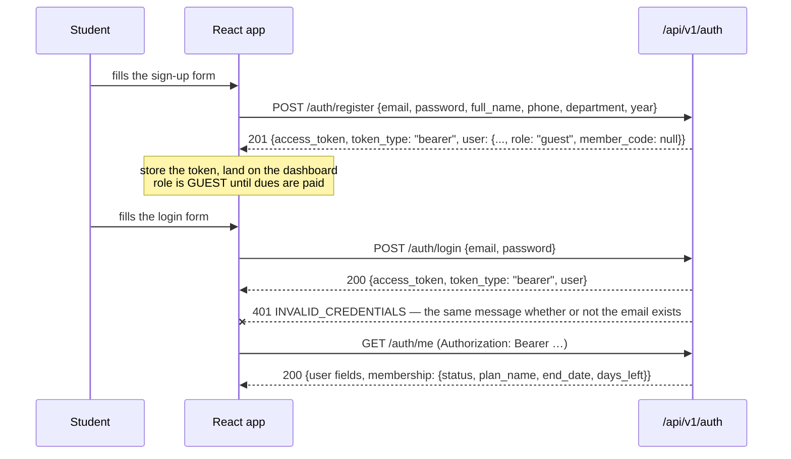
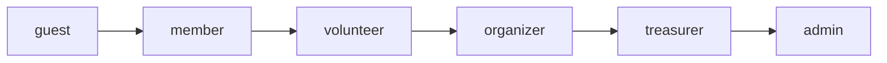
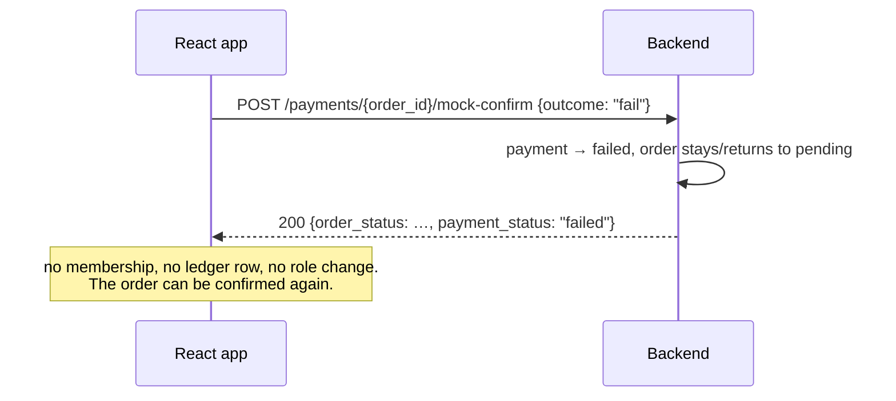
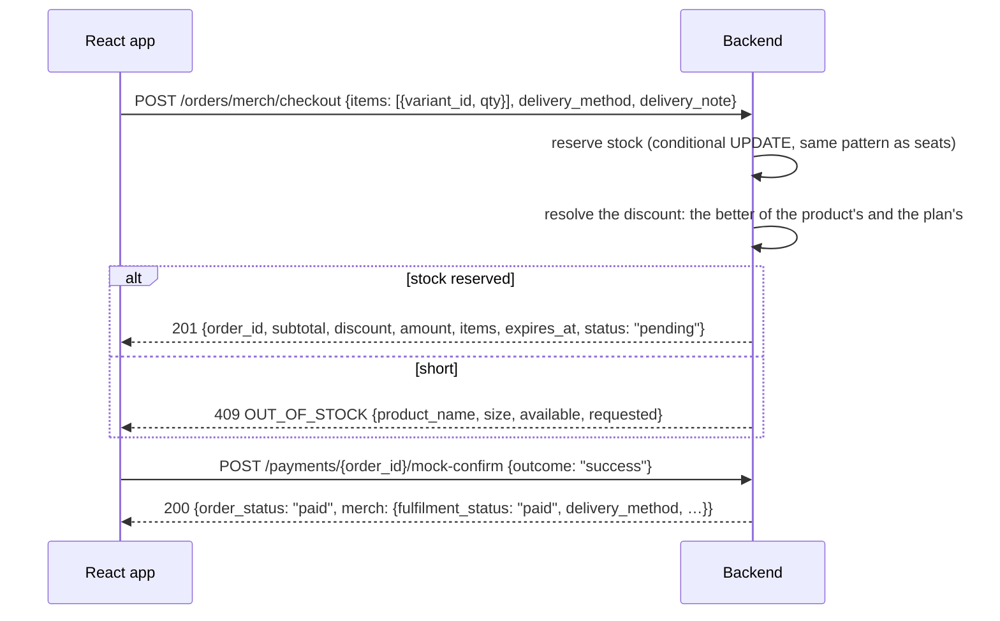

# SSA Hub — API Handoff

**Audience:** the frontend engineer connecting the React app to this backend.
**Status:** the backend is feature-complete for Milestone 1 (phases 1–6) and hardened (phase 7).
The contract below is generated from, and checked against, the running application — see
[Verifying this document](#verifying-this-document).

Read this alongside `docs/DESIGN.md` §5. DESIGN.md §5 is the route list (method, path, role);
this document is everything the route list cannot express: bodies, headers, states, timing and
the mistakes that are easy to make.

---

## 1. Base URL and versioning

| | |
|---|---|
| Local base URL | `http://localhost:8000` |
| API prefix | `/api/v1` |
| Full example | `http://localhost:8000/api/v1/events` |
| Version | `1.0.0` (`GET /health` reports it) |
| Machine-readable schema | `docs/openapi.json`, and `/openapi.json` on a running server |
| TypeScript types | `docs/api-types.ts`, generated from the above by `openapi-typescript` |
| Interactive docs | `/docs` (Swagger UI), `/redoc` |

The prefix is versioned once, for the whole API: there is no `/api/v2` and nothing is negotiated
by header. A breaking change becomes `/api/v2` in a future milestone. Within `v1`, fields are only
ever **added** — never renamed, never removed, never given a different type. If the frontend needs
a field that does not exist, that is a new field, and it will arrive as an addition in the same
version.

Set the base URL from `VITE_API_URL`. Do not hardcode it.

### Service routes (no `/api/v1` prefix)

| Method | Path | Auth | Returns |
|---|---|---|---|
| `GET` | `/health` | public | `{"status": "ok", "service": "ssa-hub-api", "version": "1.0.0"}` |

Use `/health` for a liveness probe and for the "is the backend up?" state in the UI. It touches
the database, so a 200 means the whole stack is answering.

---

## 2. Authentication

JWT bearer tokens, HS256, **valid for 7 days** (`JWT_EXPIRE_MINUTES`). There is no refresh token
and no server-side session: when the token expires the user logs in again. Store it in
`localStorage` and send it on every request.

```
Authorization: Bearer <access_token>
```

### Flow



### The three requests

**`POST /api/v1/auth/register`** → `201 TokenOut`. Public. Rate limited (see §4).

```json
{ "email": "student@ssa.org", "password": "Passw0rd!", "full_name": "Meera Kapoor",
  "phone": "9876543210", "department": "CSE", "year": 2 }
```

`phone`, `department`, `year` are optional; `email`, `password`, `full_name` are required.
The new account is **`role: "guest"`** and has **`member_code: null`** — both facts are the point,
not an oversight. See §3.

**`POST /api/v1/auth/login`** → `200 TokenOut`. Public. Rate limited.

```json
{ "email": "admin@ssa.org", "password": "Passw0rd!" }
```

**`GET /api/v1/auth/me`** → `200 MeOut`. Any authenticated user.

```json
{
  "id": "…", "email": "member@ssa.org", "full_name": "Meera Kapoor", "role": "member",
  "phone": "9876543210", "department": "CSE", "year": 2, "member_code": "SSA-2026-0007",
  "is_active": true, "email_opt_in": true,
  "created_at": "2026-07-01T09:12:44Z",
  "membership": { "status": "active", "plan_name": "Standard",
                  "end_date": "2027-04-28", "days_left": 200 }
}
```

`membership` is **never null**. A user with no membership gets
`{"status": "none", "plan_name": null, "end_date": null, "days_left": null}` — so the UI can
branch on `membership.status` without a null check first.

`membership.status` is one of `active`, `expired`, `pending`, `cancelled`, `none`.

### Password rules

Minimum 8 characters, at least one letter and at least one digit. A bad password is
`422 WEAK_PASSWORD`. Enforce the same rule in the form so the user is not told after a round trip.

### What the frontend must not do

- Never render "this email is already registered" from the login response — login always says
  `INVALID_CREDENTIALS`.
- Never store the token anywhere it outlives the tab's trust (see §18 on CORS and credentials).
- Never call an admin route on the strength of a cached `role`; the backend re-checks every time
  and a stale role yields `403`.

---

## 3. Roles

Six roles, strictly ranked. **A higher rank can do everything a lower rank can.**



| Role | Rank | How you get it | What it unlocks |
|---|---|---|---|
| `guest` | 0 | register | public content; buy a ticket at the non-member price |
| `member` | 1 | **pay dues** (automatic promotion) | member pricing, members-only announcements, merch |
| `volunteer` | 2 | an admin sets it | the scanner, fundraisers/tasks, submitting expenses |
| `organizer` | 3 | an admin sets it | creating events, ticket types, announcements, fundraisers, tasks |
| `treasurer` | 4 | an admin sets it | approving and paying claims, the whole finance area |
| `admin` | 5 | an admin sets it | products and stock, user roles, closing/reopening ledger periods |

Three facts that bite:

1. **`member` is earned, not assigned.** Registration produces a `guest`. Paying for a membership
   plan promotes them — the backend does this itself, in the same transaction as the payment. The
   frontend never sends a role. `PATCH /users/{id}/role` is admin-only and does not grant member
   pricing: **member pricing is decided by an active membership row, not by the role string.** An
   organizer whose dues lapsed is a non-member at the checkout.
2. **`+` in DESIGN.md §5 means "and above".** `treasurer+` = treasurer and admin.
   `require_role("treasurer")` accepts ranks 4 and 5, not just 4.
3. **A wrong role is `403 FORBIDDEN`, a missing or bad token is `401 UNAUTHORIZED`.** The UI should
   treat them differently: 401 → log in again; 403 → "you don't have access to this", and hide the
   control that led there.

`GET /api/v1/auth/me` is the authoritative source for what to show. Read `role` from it after
login and after any membership purchase.

---

## 4. Errors

### Shape

Every error, from every route, without exception:

```json
{
  "error": {
    "code": "SOLD_OUT",
    "message": "Not enough seats left",
    "details": { "seats_left": 0, "requested": 1 }
  }
}
```

- `code` — stable, machine-readable, `SCREAMING_SNAKE_CASE`. **Branch on this.**
- `message` — human English, safe to show. It is not localised and not a UI string.
- `details` — always present, `{}` when there is nothing to add. Shape depends on `code`
  (documented per code below). Never parse `message` for data that `details` carries.

The frontend should have exactly one error interceptor that unwraps this envelope. A network
failure or a non-JSON body is a different case — treat it as "the server is unreachable".

### HTTP status policy

| Status | Means | UI treatment |
|---|---|---|
| 400 | malformed request (bad/missing query parameter) | developer error; log it |
| 401 | missing, expired or invalid token | clear the token, go to login |
| 403 | authenticated but not allowed | "not your call"; hide the control |
| 404 | no such thing, **or you may not know it exists** | empty state |
| 409 | the resource conflicts with its current state | show the reason; usually a retry after a refresh |
| 413 | file too large | shrink-the-file message |
| 422 | the payload failed validation | map `details.fields` onto the form |
| 429 | rate limited | back off for `Retry-After` seconds |
| 500 | a bug | generic "something broke" + the request id |
| 502 | the storage provider is unreachable | retry later |

`409` is used consistently for state conflicts — sold out, already checked in, a claim already
paid, a closed period. It is never a validation failure.

### Validation errors

`422 VALIDATION_ERROR` carries a **field list**, so a form can highlight inputs rather than show
one banner:

```json
{
  "error": {
    "code": "VALIDATION_ERROR",
    "message": "Request payload is invalid",
    "details": { "fields": [
      { "field": "password", "message": "String should have at least 8 characters" },
      { "field": "email", "message": "value is not a valid email address" }
    ] }
  }
}
```

`field` is a dot path into the payload (`items.0.qty` for a list element). Map it to the input by
name. A field absent from the list is valid.

### Rate limits

Phase 7 added in-memory limits. They are per process, and the app runs as **one worker**.

| Route group | Limit | Key |
|---|---|---|
| `POST /auth/login` | 10/min | client IP |
| `POST /auth/register` | 10/min | client IP |
| `POST /checkin` | 120/min | user |
| `POST /tickets/checkout`, `POST /orders/merch/checkout` | 30/min | user |

Exceeding one is `429 TOO_MANY_REQUESTS` with a `Retry-After` header in seconds, in the standard
envelope. Read the header; do not hardcode 60.

**Failed logins are counted separately:** 5 consecutive failures for one email locks that email
for **15 minutes**, answered with the same `429`. A success resets the counter. The failure
message never reveals whether the email exists.

If your dev server has `RATE_LIMIT_ENABLED=false` (the test suite sets this), none of the above
applies — do not build the UI around a limit you cannot reproduce locally.

### Full error-code table

Grouped by area. "UI" is the suggested user-facing move, not a string to copy verbatim.

#### Auth and accounts

| HTTP | Code | When | `details` | UI |
|---|---|---|---|---|
| 401 | `INVALID_CREDENTIALS` | wrong email or password | — | "Email or password is incorrect" — never say which |
| 401 | `UNAUTHORIZED` | no token, expired token, bad signature | — | clear the token, redirect to login |
| 403 | `ACCOUNT_DISABLED` | `is_active` is false | — | "This account has been disabled" |
| 403 | `FORBIDDEN` | role too low | `{"roles": [...]}` | hide the control; don't route them here |
| 404 | `USER_NOT_FOUND` | no such user | — | empty state |
| 409 | `EMAIL_TAKEN` | registering an email that exists | — | inline on the email field: "already registered — log in" |
| 422 | `WEAK_PASSWORD` | password fails the policy | — | inline on the password field, with the rule |
| 422 | `VALIDATION_ERROR` | any schema failure | `fields[]` | map onto inputs |
| 429 | `TOO_MANY_REQUESTS` | rate limited or locked out | — | disable the button for `Retry-After` seconds |

#### Membership and plans

| HTTP | Code | When | `details` | UI |
|---|---|---|---|---|
| 404 | `PLAN_NOT_FOUND` | the plan id does not exist or is retired | — | refresh the plan list |
| 404 | `MEMBERSHIP_NOT_FOUND` | asking for a membership that isn't there | — | show "join" instead |
| 403 | `MEMBERSHIP_REQUIRED` | merch order from a non-member | — | "Members only — join or renew" + a link to plans |
| 409 | `PLAN_NAME_TAKEN` | admin creating a duplicate plan name | — | inline on the name field |
| 409 | `NOT_A_MEMBERSHIP_ORDER` | confirming a non-membership order here | — | developer error |

#### Events and tickets

| HTTP | Code | When | `details` | UI |
|---|---|---|---|---|
| 404 | `EVENT_NOT_FOUND` | unknown event id | — | empty state |
| 404 | `TICKET_TYPE_NOT_FOUND` | unknown ticket-type id | — | refresh the event |
| 404 | `TICKET_NOT_FOUND` | unknown ticket id | — | empty state |
| 404 | `ORDER_NOT_FOUND` | unknown order id | — | empty state |
| 404 | `PAYMENT_NOT_FOUND` | the order has no payment row | — | developer error |
| 409 | `SOLD_OUT` | not enough seats | `{seats_left, requested}` | "Only N left" — **refresh the event, the number is stale** |
| 409 | `EVENT_NOT_ON_SALE` | event is draft or closed | `{status}` | hide the buy button |
| 409 | `NOT_IN_SALE_WINDOW` | before `sale_starts_at` / after `sale_ends_at` | — | show the window |
| 409 | `CAPACITY_BELOW_SOLD` | organizer shrinking capacity below sold | `{sold_count, capacity}` | inline on the capacity field |
| 409 | `INVALID_STATUS_TRANSITION` | e.g. draft → closed | `{from, to}` | only offer legal next states |
| 409 | `ORDER_NOT_PAYABLE` | confirming a checkout that expired | — | "that checkout expired" + start again |
| 409 | `NOT_A_TICKET_ORDER` | confirming a non-ticket order here | — | developer error |
| 500 | `CODE_GENERATION_FAILED` | could not mint a unique ticket code | — | retry the checkout; if it persists, it is a bug |

#### Check-in

| HTTP | Code | When | `details` | UI |
|---|---|---|---|---|
| 404 | `EVENT_NOT_FOUND` | scanning for an unknown event | — | re-pick the event |

Note there is **no error code for a bad ticket** — see §11. Check-in always answers `200`.

#### Announcements and email preferences

| HTTP | Code | When | `details` | UI |
|---|---|---|---|---|
| 404 | `ANNOUNCEMENT_NOT_FOUND` | unknown post, **or one you may not see** | — | empty state — do not distinguish |
| 409 | `PIN_LIMIT_REACHED` | more than 3 pinned posts | `{max_pinned}` | "unpin one first" |
| 422 | `AUDIENCE_LOCKED` | changing `audience`/`event_id` after posting | `{field}` | "post a new announcement instead" |
| 422 | `EVENT_REQUIRED` | `audience: "event"` with no `event_id` | — | inline on the event picker |
| 422 | `EVENT_NOT_ALLOWED` | `event_id` sent with a non-event audience | `{audience}` | clear the field; it is ignored |
| 422 | `REVISION_NOTE_REQUIRED` | editing a posted announcement without a note | `{min_length}` | prompt for the reason before saving |
| 400 | `INVALID_TOKEN` | bad or expired unsubscribe link | — | "this link is no longer valid" |
| 400 | `MISSING_QUERY` | member lookup with neither `?code=` nor `?q=` | — | developer error |
| 409 | `AMBIGUOUS_QUERY` | a name search matching several members | — | "several matches — use the member code" |

#### Merchandise

| HTTP | Code | When | `details` | UI |
|---|---|---|---|---|
| 404 | `PRODUCT_NOT_FOUND` | unknown or retired product | — | empty state |
| 404 | `VARIANT_NOT_FOUND` | unknown variant | — | refresh the product |
| 404 | `MERCH_ORDER_NOT_FOUND` | no such merch order / payment not succeeded yet | — | empty state |
| 409 | `OUT_OF_STOCK` | not enough units | `{variant_id, product_name, size, available, requested}` | "Only N left of M" — refresh the product |
| 409 | `PRODUCT_UNAVAILABLE` | variant retired between listing and checkout | `{product_name, size}` | refresh the product |
| 409 | `NEGATIVE_STOCK` | admin adjustment below zero | `{stock, delta}` | inline on the stock field |
| 409 | `INVALID_TRANSITION` | fulfilment skip, e.g. paid → handed_over | `{from, to, allowed}` | only offer `allowed` |
| 422 | `DUPLICATE_VARIANT` | the same variant twice in one order | `{variant_id}` | merge the lines |
| 422 | `SKU_TAKEN` | duplicate SKU | `{sku}` | inline on the SKU field |
| 422 | `VARIANT_TAKEN` | the same size/colour already exists | `{size, color}` | inline on the size field |
| 422 | `DELIVERY_NOTE_REQUIRED` | campus delivery without a note | `{min_length}` | prompt for block/room |
| 502 | `STORAGE_UNAVAILABLE` | the image store is unreachable | — | retry later |

#### Fundraisers and tasks

| HTTP | Code | When | `details` | UI |
|---|---|---|---|---|
| 404 | `FUNDRAISER_NOT_FOUND` | unknown fundraiser | — | empty state |
| 404 | `TASK_NOT_FOUND` | unknown task | — | refresh the board |
| 403 | `NOT_OWNER` | a non-owner organizer editing a fundraiser | — | hide the edit control |
| 409 | `FUNDRAISER_CLOSED` | editing the board of a `done` fundraiser | — | read-only board |
| 409 | `INVALID_TRANSITION` | skipping a fundraiser status step | `{from, to}` | only offer the next step |
| 409 | `OPEN_TASKS` | closing a fundraiser with open tasks | `{open_count}` | confirm, then retry with `force: true` |
| 422 | `DUE_AFTER_EVENT` | a task due after the fundraiser's date | `{due_date, event_date}` | inline on the date |
| 422 | `INVALID_ASSIGNEE` | assignee is not an active volunteer+ | — | restrict the picker to `GET /users/assignable` |
| 422 | `INVALID_OWNER` | owner is not an active organizer+ | — | restrict the picker |

#### Expenses

| HTTP | Code | When | `details` | UI |
|---|---|---|---|---|
| 404 | `EXPENSE_NOT_FOUND` | unknown claim | — | empty state |
| 404 | `RECEIPT_NOT_FOUND` | the claim has no receipt attached | — | hide the receipt button |
| 403 | `FORBIDDEN` | a volunteer touching someone else's claim | `{roles}` | hide it |
| 409 | `SELF_REVIEW` | approving or paying **your own** claim | — | "someone else must approve this" |
| 409 | `INVALID_STATE` | acting on a claim in the wrong state | `{status, action}` | refresh; only offer legal actions |
| 409 | `RECEIPT_REQUIRED` | approving a claim above the receipt threshold with no receipt | — | prompt for the upload |
| 409 | `INSUFFICIENT_FUNDS` | reimbursing would overdraw the club | `{balance, amount}` | "the club balance is too low"; an admin can override |
| 413 | `FILE_TOO_LARGE` | receipt over the size cap | `{max_bytes}` | shrink the file |
| 422 | `INVALID_FILE_TYPE` | receipt is not JPEG/PNG/WebP/PDF | `{allowed}` | inline on the file input |
| 422 | `INVALID_INCURRED_ON` | claim dated in the future or too far back | `{max_days}` | constrain the date picker |
| 502 | `STORAGE_UNAVAILABLE` | receipt upload failed upstream | — | retry |

#### Finance and ledger

| HTTP | Code | When | `details` | UI |
|---|---|---|---|---|
| 404 | `PERIOD_NOT_FOUND` | unknown period | — | empty state |
| 404 | `TRANSACTION_NOT_FOUND` | unknown ledger row | — | refresh the ledger |
| 409 | `PERIOD_CLOSED` | writing to a closed period | `{period_name, start_date, end_date}` | "that date is inside a closed period" |
| 409 | `PERIOD_OVERLAP` | a new period overlaps an existing one | `{overlap_name}` | show the clashing range |
| 409 | `PERIOD_NAME_TAKEN` | duplicate period name | — | inline on the name |
| 409 | `PENDING_CLAIMS` | closing a period with unsettled claims inside it | `{count}` | list them; settle first |
| 409 | `RECONCILIATION_FAILED` | closing while the books disagree | `{checks}` | send the treasurer to the reconcile view |
| 409 | `ALREADY_REVERSED` | reversing a row twice | `{transaction_id}` | refresh the ledger |
| 409 | `NOT_REVERSIBLE` | reversing a reversal | — | hide the action on reversal rows |
| 422 | `INVALID_OCCURRED_AT` | future date, or older than the backdate window | `{max_days}` | constrain the date picker |
| 422 | `INVALID_LEDGER_ROW` | a manual entry whose direction contradicts its source | `{source, expected}` | derive the direction from the source |

#### Everything else

| HTTP | Code | When | UI |
|---|---|---|---|
| 404 | `*_NOT_FOUND` | any unknown id | empty state |
| 405 | `METHOD_NOT_ALLOWED` | wrong HTTP verb for a real path | developer error |
| 500 | `INTERNAL_ERROR` | a bug | "something went wrong"; quote the request id |
| 500 | `STORAGE_NOT_CONFIGURED` | backend misconfiguration | operator problem, not the user's |

### Request IDs

Every response carries **`X-Request-ID`**: the value you sent, or one the server generated. It is
in every server log line for that request. Send your own on each request (a UUID) and quote it in
any bug report or error toast — it is the difference between "the save button broke" and a
five-minute diagnosis.

### Security headers

Every response sets `X-Content-Type-Options: nosniff`, `X-Frame-Options: DENY` and
`Referrer-Policy: no-referrer`. Nothing for the frontend to do; noted so their presence is not a
surprise.

---

## 5. Pagination

Every list endpoint returns the same envelope:

```json
{ "items": [ … ], "total": 137, "page": 1, "page_size": 20 }
```

- Query parameters: `page` (default `1`, min `1`) and `page_size` (default `20`, min `1`, max `100`).
- `page_size` above 100 is a `422` — clamp it in the client.
- `total` is the count for the whole filter, not the page. Use it for the pager.
- Out-of-range pages return an **empty `items` with the real `total`** — not a 404.
- An unpaged list endpoint does not exist; the ones that return a bare array are small by
  construction (`/finance/by-event`, `/finance/by-fundraiser`, `/plans`, `/products`, the task
  board).

`GET /events` is the exception worth knowing: it returns `Page[EventListItem]` and its items
carry `min_price` and `seats_left` **for the calling user** (member pricing when a token is sent).
Send the token on public GETs so the prices are right.

---

## 6. Money

**Every amount in this API is an integer number of paise.** There is no float anywhere, in any
field, in any response. ₹1,250.50 is `125050`.

- Paise fields are named plainly: `amount`, `total`, `price`, `subtotal`, `discount`, `balance`,
  `unit_price`, `price_paid`, `goal_amount`, `total_in`, `total_out`, `net`, `min_price`.
- `signed_amount` on a ledger row is the one signed field: **negative for money out**, positive for
  money in. It is for sorting and charts. Do not sum `amount` and expect a signed total.
- Money is never a string, never has a currency prefix, never carries decimals.
- The currency is always INR. There is no `currency` field to switch on for amounts;
  `OrderOut.currency` exists and is always `"INR"`.

Display with `formatINR(paise)`:

```ts
export const formatINR = (paise: number) =>
  new Intl.NumberFormat("en-IN", { style: "currency", currency: "INR" })
    .format(paise / 100);
```

**Rounding.** Percentages are applied server-side with half-up integer arithmetic, so the discount
you compute in the UI may differ by one paisa from the server's. Always render the server's
`unit_price`, `subtotal`, `discount` and `amount`; never recompute a payable total on the client.
If the UI must preview a price, show it as an estimate and reconcile after the request.

---

## 7. `Idempotency-Key`

Four state-changing endpoints write money. They accept an optional
`Idempotency-Key` header (exact spelling: capital `I`, capital `K`). If you send one, the backend
remembers it and:

- the **first** request does the work and returns `replayed: false` (where the field exists);
- a **repeat** with the same key returns the **same row**, writes **nothing new**, and reports
  `replayed: true`.

| Endpoint | Idempotent on |
|---|---|
| `POST /api/v1/tickets/checkout` | the order |
| `POST /api/v1/orders/merch/checkout` | the order |
| `POST /api/v1/fundraisers/{id}/income` | the income row (`replayed` in the response) |
| `POST /api/v1/finance/transactions` | the ledger row |

**Send a fresh key for every distinct user intent** — a UUID generated when the button is pressed,
not when the component mounts. This is what makes a retry after a timeout safe, and it is what
stops a double-tap from selling two tickets:

```ts
const key = crypto.randomUUID();
await api.post("/api/v1/tickets/checkout", body, { headers: { "Idempotency-Key": key } });
```

Reusing one key for two genuinely different purchases will silently return the first one's result.
A key is scoped per user and per endpoint; there is no need to make it globally unique, but there
is no harm in doing so.

Everything else is naturally idempotent or naturally not: `PATCH` is idempotent by nature, and
`POST /payments/{order_id}/mock-confirm` is guarded internally — confirming the same order twice
does not double-charge or double-issue.

---

## 8. Multipart uploads

**One endpoint takes a file: `POST /api/v1/expenses`.** It is `multipart/form-data`, not JSON.

| Part | Type | Notes |
|---|---|---|
| `amount` | text field | integer **paise**, e.g. `"45000"` |
| `description` | text field | 5–300 characters |
| `category` | text field | `supplies`, `food`, `printing`, `venue`, `travel`, `marketing`, `equipment`, `other` |
| `incurred_on` | text field | `YYYY-MM-DD`; not the future, not more than 90 days back |
| `event_id` | text field, optional | attribute the claim to an event |
| `fundraiser_id` | text field, optional | attribute the claim to a fundraiser |
| `receipt` | **file**, optional | JPEG, PNG, WebP or PDF, within the size cap |

Every scalar part is sent as a **string** — that is what multipart does, and `"45000"` is not `45000`.
The API validates and coerces them; a form built with `FormData` and `append` is correct as-is.

```ts
const form = new FormData();
form.append("amount", String(paise));
form.append("description", description);
form.append("category", category);
form.append("incurred_on", incurredOn);            // "2026-10-10"
if (receiptFile) form.append("receipt", receiptFile);
await api.post("/api/v1/expenses", form);          // do NOT set Content-Type by hand
```

Two traps:

1. **Do not set `Content-Type` yourself.** The browser must set it, because it has to include the
   multipart boundary. Setting `"multipart/form-data"` by hand strips the boundary and the request
   becomes unparseable.
2. **`PUT /api/v1/expenses/{id}/receipt` replaces the receipt** on an open claim. It takes the same
   `receipt` part and nothing else.

Receipts are the only upload. Product images are set by URL (`image_url`), not uploaded.

---

## 9. Payments (mock provider)

Payments are **mocked** in Milestone 1. There is no gateway and no webhook: the frontend asks the
backend to simulate the outcome. This is a deliberate scope decision — the Razorpay integration is
M2 work, and the interface it will implement is the one below.

### Membership purchase

```mermaid
sequenceDiagram
    participant U as Student
    participant F as React app
    participant B as Backend
    participant L as Ledger

    U->>F: picks a plan, taps "Pay"
    F->>B: POST /memberships/checkout {plan_id}
    B->>B: create order (pending) + payment (pending)
    B-->>F: 201 {order_id, payment_id, amount, provider, status: "pending"}

    Note over F: the mock sheet opens<br/>"Simulate success" / "Simulate failure"

    F->>B: POST /payments/{order_id}/mock-confirm {outcome: "success"}
    B->>B: claim pending → paid (atomic; a repeat changes nothing)
    B->>L: INSERT ledger row (source="dues", direction="in")
    B->>B: activate membership, issue member_code, promote guest → member
    B-->>F: 200 {order_status: "paid", membership: {status: "active", end_date, days_left}}

    F->>B: GET /auth/me
    B-->>F: role is now "member", member_code is set
```



The membership story in one line: **checkout → mock-confirm → the user is a member.**
`POST /memberships/checkout` on a user who is already an active member is a **renewal**, not a
duplicate — it extends `end_date` by the plan's duration.

### Ticket purchase

```mermaid
sequenceDiagram
    participant F as React app
    participant B as Backend
    participant S as Seats

    F->>B: POST /tickets/checkout {ticket_type_id, quantity}
    B->>S: reserve seats: UPDATE … SET sold_count = sold_count + n<br/>WHERE capacity - sold_count >= n
    Note over B,S: the UPDATE is the lock. Zero rows affected = sold out.<br/>No advisory locks, no session state — the app runs on a transaction pooler.
    alt seats reserved
        B-->>F: 201 {order_id, payment_id, amount, unit_price, is_member_price, quantity, status: "pending"}
    else not enough left
        B-->>F: 409 SOLD_OUT {seats_left, requested}
    end

    F->>B: POST /payments/{order_id}/mock-confirm {outcome: "success"}
    B->>B: order → paid, payment → succeeded
    B->>B: mint one ticket per seat, each with its own 10-char code
    B-->>F: 200 {order_status: "paid", tickets: [TicketOut, …]}

    Note over F: tickets carry `code` — the string the door scans.<br/>Show them immediately; do not make the user re-fetch.
```

A **free** ticket type (`member_price: 0`) skips the payment step entirely: checkout returns
`status: "paid"` with the tickets already in the body. **Branch on `status`, do not assume
`pending`** — a paid-then-confirmed flow that forgets this will hang on a free event.

If the user abandons the mock sheet, the reservation is released after 15 minutes (§10).

### Merchandise purchase

Same two-step shape as tickets, with stock instead of seats, and one extra twist: the member
discount is resolved at checkout and frozen onto the order.



`delivery_method` is `"pickup"` or `"campus_delivery"`. A campus delivery **requires**
`delivery_note` (a block or room), else `422 DELIVERY_NOTE_REQUIRED`.

After payment the order enters the fulfilment pipeline: `paid → packed → handed_over`, one step at
a time, admin-only. `PATCH /admin/merch/orders/{id}` with anything but the next step is
`409 INVALID_TRANSITION` and the error's `details.allowed` names the only accepted value.

### What the mock means for the UI

- There is no redirect, no popup and no callback URL. The "gateway" is a button you render.
- **Always handle `fail`.** The happy path is one branch; `{outcome: "fail"}` must leave the user
  able to try again, because the order is still payable.
- Do not poll for payment state. The confirm response is the final state.
- Everything above is one swap away from the real thing: M2 replaces `mock-confirm` with a
  webhook, and the request/response shapes on either side of it do not change.

---

## 10. Reservations, `expires_at` and the 15-minute rule

An unpaid ticket or merch order **holds** its seats or stock so two people cannot buy the last one
while the first is still typing their card details. The hold lasts **15 minutes**.

- `MerchCheckoutOut.expires_at` (and the ticket order's equivalent) is when the hold dies.
  **Render a countdown from it.** It is an absolute UTC instant, not a duration.
- When it passes, a background sweep cancels the order and returns the seats/stock to the pool.
  The sweep runs every **5 minutes**, so a lapsed hold may linger a few minutes past `expires_at`
  before the stock reappears in a listing. Do not treat that as a bug.
- Confirming a lapsed order is `409 ORDER_NOT_PAYABLE` with the message "this order was cancelled
  because its checkout expired". The right UI response is **not** an error banner: it is "that
  checkout timed out — start again", with a fresh checkout button.
- The sweep is also what protects the inventory if the user simply closes the tab. Nothing is
  leaked; the reservation expires on its own.

Practical frontend rule: if `expires_at` is in the past and the user is still on the payment
screen, disable the pay button and offer a fresh checkout rather than letting them submit into a
409.

---

## 11. Check-in

`POST /api/v1/checkin` — the scanner. Requires `volunteer` or above.

```json
{ "event_id": "…", "code": "K7PQ2MX9RT" }
```

**It always returns `200.**` A door needs an answer, not an error page. The outcome is the
`result` field, and the UI must branch on that:

| `result` | Meaning | UI |
|---|---|---|
| `VALID` | admitted; the ticket is now `used` | **green, full screen.** Show `holder_name`, `ticket_type` and the running `checked_in` count |
| `ALREADY_USED` | this ticket was already scanned | **amber.** Show `checked_in_at` — "already used at 6:41 PM". A person, not a fraud |
| `INVALID` | no such code | **red.** "Not a valid ticket" |
| `WRONG_EVENT` | a real ticket, but for another event | **red.** The `message` names the event it belongs to |

The response also carries live counters for the scanner header: `checked_in` (in so far) and
`sold` (tickets issued). Both are for this event only.

```json
{
  "result": "VALID",
  "ticket": { "id": "…", "code": "K7PQ2MX9RT", "status": "used", "price_paid": 100000,
              "is_member_price": true, "checked_in_at": "2026-10-10T18:41:02Z" },
  "holder_name": "Meera Kapoor",
  "ticket_type": "Balcony",
  "checked_in_at": "2026-10-10T18:41:02Z",
  "message": "Welcome, Meera Kapoor",
  "checked_in": 41,
  "sold": 120
}
```

Design notes for the scanner screen:

- **Colour plus text, never colour alone.** Readable at arm's length, in sunlight, by a volunteer
  who has never used it. A 3-second auto-dismiss back to the input is right for `VALID`; require a
  tap to dismiss `ALREADY_USED`, `INVALID` and `WRONG_EVENT` so the volunteer actually reads them.
- The scanner is rate limited to **120 scans/minute per user**. That is generous for one phone and
  tight for a shared account across a door — **use one volunteer account per scanning device.**
  A 429 here must not wedge the screen: show it and keep accepting scans.
- Codes are 10 characters, uppercase alphanumeric, no ambiguous characters. Trim whitespace and
  uppercase the input before sending; the backend normalises, but consistency avoids surprises.
- The same volunteer can scan for two different events without logging out — `event_id` is in the
  body.
- `ALREADY_USED` is not an error to be alarmed about. People re-scan. Show the time and move on.

---

## 12. Announcement visibility

The feed is **not** a flat list. `GET /api/v1/announcements` returns exactly what the caller may
see, decided server-side by one shared rule:

| Caller | Sees |
|---|---|
| anonymous (`guest`, no token) | `audience: "all"` posts only |
| signed-in, **no active membership** | the above |
| **active member** | the above **+ `audience: "members"`** |
| any signed-in user | the above **+ `audience: "event"` posts for events they hold a valid/used ticket for** |
| `organizer` and above | **everything**, including posts about events they never attended |

Three consequences for the UI:

1. **A post you may not see is a `404`, not a `403`.** The existence of a members-only post is
   itself information. Do not render a "no permission" state for a 404 from an announcement route
   — render the normal empty state, exactly as if the id were wrong.
2. **The feed changes when the user's membership changes.** After a successful dues payment, the
   members-only posts appear. Invalidate the announcements query on membership change.
3. `audience: "event"` requires `event_id`; the two are checked together
   (`422 EVENT_REQUIRED` / `422 EVENT_NOT_ALLOWED`). `audience` and `event_id` are **locked after
   posting** — changing either is `422 AUDIENCE_LOCKED`. To retarget a post, post a new one.

Editing a posted announcement's title, body or category requires a `revision_note` (3+ characters),
which is stored and served by `GET /announcements/{id}/revisions` as the post's edit history.
Prompt for the reason in the edit dialog; a silent edit is rejected.

`is_pinned` posts come first in the feed. At most **3** may be pinned; the fourth is
`409 PIN_LIMIT_REACHED`.

### Delivery

Posting an announcement queues deliveries in the same transaction and returns a
`delivery_summary`:

```json
{ "inapp_queued": 140, "email_queued": 40, "skipped_opted_out": 3 }
```

`skipped_opted_out` counts audience members who switched email off — they still get the in-app
notice. The email queue is drained by a background job **every 60 seconds**, so `email_queued > 0`
is normal and not a failure. Watch the summary on the admin deliveries screen
(`GET /announcements/{id}/deliveries`), which also reports per-channel `queued`/`sent`/`failed`
counts. A member can opt out at `GET`/`POST /users/me/email-preferences`; the unsubscribe link in
the email lands on `GET /unsubscribe?token=…` and needs no auth.

---

## 13. Fundraiser progress and health

`GET /api/v1/fundraisers/{id}` returns `progress` alongside the fundraiser. The UI's job is to
show it, not to compute it.

```json
{
  "tasks": { "total": 8, "todo": 4, "doing": 1, "done": 3,
             "overdue": 1, "due_soon": 2, "unassigned": 3, "percent_done": 38 },
  "raised": 200000, "spent": 0, "net_raised": 200000,
  "goal": 500000, "percent_of_goal": 40,
  "days_to_event": 10, "health": "at_risk",
  "by_category": [{ "category": "baking", "total": 3, "done": 1 }],
  "by_assignee": [{ "assignee_id": "…", "name": "Vidya Nair", "total": 3, "done": 1 }]
}
```

- **`raised` is gross** — every `in` row for this fundraiser. **`spent`** is reimbursed claims
  charged to it, and **`net_raised` is `raised − spent`**. Show `raised` against the goal (that is
  what the club promised) and `net_raised` as the second line if it differs.
- `percent_of_goal` is a **whole percent and can exceed 100**. A beaten goal is good news; let the
  bar fill and the number go past 100 rather than clamping.
- `days_to_event` goes **negative** after the date. Render "-3 days" as "3 days ago".
- `health` is one of `on_track`, `at_risk`, `behind`, **`completed`**. It is derived from the
  task board and the date — do not recompute it, and do not invent a fifth value.
- `tasks.overdue` counts cards past `due_date` and not done; `due_soon` counts those due within
  3 days; `unassigned` counts open cards with nobody's name on them. These are the three things
  a volunteer should act on, so surface them as filters, not as decoration.

Status moves `planning → active → done`, **one step at a time**; a skip is
`409 INVALID_TRANSITION`. Closing with open tasks is `409 OPEN_TASKS` with the count — ask the
user to confirm, then retry with `{"status": "done", "force": true}`. Once `done`, the board is
read-only (`409 FUNDRAISER_CLOSED`).

The list endpoint returns `FundraiserProgressSummary` — the same numbers, flattened
(`tasks_total`, `tasks_done`, …) because a card has no room for the nested shape.

---

## 14. Finance response shapes

Everything here is `treasurer` or above. `treasurer+` means treasurer and admin.

**`GET /finance/summary?from=&to=`** — the dashboard. `balance` is `total_in − total_out` **for the
window**, not the club's lifetime balance; with no parameters the window is everything.

```json
{
  "date_from": null, "date_to": null,
  "total_in": 9811100, "total_out": 173000, "balance": 9638100,
  "by_source": [{ "source": "tickets", "in": 5230000, "out": 0, "net": 5230000 }],
  "by_category": [{ "category": "travel", "amount": 45000 }],
  "pending_reimbursements": { "submitted_count": 2, "submitted_amount": 278000,
                              "approved_unpaid_count": 1, "approved_unpaid_amount": 96000 },
  "by_month": [{ "month": "2026-09", "in": 1200000, "out": 45000 }],
  "counts": { "transactions": 24, "expenses_reimbursed": 6 }
}
```

**`GET /finance/transactions`** — `Page[TransactionOut]`, the ledger table. Each row carries
`direction` (`in`/`out`), positive `amount`, signed `signed_amount`, a human `label`, the source,
optional `event_title`/`fundraiser_title`/`actor`, and `is_reversal` + `reverses_id`. Rows are
**immutable** — they are never edited or deleted, only ever reversed by a new row. Do not offer an
edit or delete affordance on a ledger row; offer `POST /finance/transactions/{id}/reverse`.

**`GET /finance/by-event` / `by-fundraiser`** — bare arrays of
`{id, title, total_in, total_out, net, goal_amount?}`. `goal_amount` is present only for
fundraisers.

**`GET /finance/reconcile`** — the health check the treasurer opens first.

```json
{ "ok": true, "checks": [ { "name": "ledger_vs_orders", "ledger_total": 5230000,
                            "source_total": 5230000, "difference": 0, "ok": true } ] }
```

`ok` is the headline; when it is false, show the checks whose `ok` is false with their
`difference`. A non-zero difference is what the treasurer came to see.

**`GET /finance/report?from=&to=`** — the semester report. `income` and `expenses` are nested
objects (`income.total`, `expenses.total`), plus `by_event`, `by_fundraiser`,
`outstanding_reimbursements`, `top_expenses` and its own `reconciliation`.
**`closing_balance` always equals `opening_balance + net_movement`** — if the UI ever shows
otherwise it has a bug, not a rounding problem.

**`GET /finance/outstanding-reimbursements`** — who is owed what, grouped by person:
`{user: {id, name}, submitted_amount, approved_unpaid_amount, oldest_pending_date}`.

**`GET /finance/periods`** — closed/reopened accounting periods:
`{id, name, start_date, end_date, status, closing_balance, closed_by, closed_at, reopened_by,
reopened_at, reopen_reason}`. `status` is `closed` or `reopened`.

### The four write operations

| Request | Effect |
|---|---|
| `POST /finance/transactions` | a manual ledger row (`other_income` / `other_expense`), backdatable up to 60 days. Honours `Idempotency-Key` |
| `POST /finance/transactions/{id}/reverse` | writes a compensating row with `is_reversal: true`. Reversing a reversal is `409 NOT_REVERSIBLE`; reversing twice is `409 ALREADY_REVERSED`. Body: `{reason}` (5+ chars) |
| `POST /finance/periods` | close a period. Body: `{name, start_date, end_date, force?}`. `end_date` must be in the past. Refused while claims dated inside are unsettled (`PENDING_CLAIMS`) or the books disagree (`RECONCILIATION_FAILED`); `force: true` overrides both and is **admin-only** |
| `POST /finance/periods/{id}/reopen` | **admin only.** Body: `{reason}` (10+ chars). Moves the period back to `reopened` and lets entries land inside it again |

Once a period is closed, any write dated inside it is `409 PERIOD_CLOSED` — including a manual
entry, a backdated income row, and a reimbursement for a claim dated in that range. When the UI
shows a date picker for anything financial, disabling the dates inside closed periods (from
`GET /finance/periods`) prevents a guaranteed 409.

---

## 15. Receipts: 10-minute signed URLs

Receipt files live in a **private** bucket. There is no public URL for a receipt, and the response
bodies **never** contain the storage path. `GET /api/v1/expenses/{id}/receipt` mints a temporary
URL instead:

```json
{ "url": "https://…/storage/v1/object/sign/receipts/…?token=…", "expires_in": 600,
  "mime": "image/png", "size": 24680 }
```

Rules the frontend must live with:

1. **The URL is valid for 600 seconds (10 minutes)**, once. Do not cache it, do not store it, do
   not put it in a React Query cache that survives ten minutes, and do not render it into a list —
   fetch it when the user opens the receipt and let it go.
2. **Never construct the URL yourself.** The signature is the authorisation.
3. A stale URL fails at the storage provider, not at this API — the browser will show an image
   error, not our error envelope. Handle `onError` on the image and re-request the URL once. If it
   fails twice, the object is gone.
4. Only **the claimant and `treasurer`+** can mint one. A volunteer fetching a colleague's receipt
   is a `403`/`404`.
5. `400`-class failures are `404 RECEIPT_NOT_FOUND` (nothing attached) or
   `502 STORAGE_UNAVAILABLE` (provider down).

A claim's `has_receipt`, `receipt_mime` and `receipt_size` are safe to show; the path is not, and it
is not sent.

---

## 16. Dates and times

Two different things, two different formats. Getting this wrong is the most common integration bug.

**Timestamps are UTC, ISO-8601, with a `Z`.** `starts_at`, `created_at`, `occurred_at`,
`checked_in_at`, `expires_at`, `sent_at`, `packed_at`, `generated_at` — all of them. Convert to
local time for display, and do it explicitly:

```ts
new Date(iso).toLocaleString("en-IN", { dateStyle: "medium", timeStyle: "short" });
```

**Dates are plain calendar days, `YYYY-MM-DD`, with no time and no zone.** `incurred_on`,
`start_date`, `end_date`, `event_date`, `due_date`, `valid_until`. These are days, not instants —
**do not put them through `new Date()` and back**, because the timezone shift can move them a day.
Format them as strings:

```ts
const formatDay = (day: string) =>           // "2026-10-10" -> "10 Oct 2026"
  new Date(day + "T00:00:00").toLocaleDateString("en-IN",
    { day: "numeric", month: "short", year: "numeric" });
```

Sending them back: send exactly what you display. `incurred_on: "2026-10-10"`.

Formatting rules for the API:

- Send timestamps as ISO-8601 UTC. `2026-10-10T18:00:00Z` or with an offset — both are accepted and
  converted. A naive `"2026-10-10T18:00:00"` is read as UTC, so include the `Z` and be sure.
- Send dates as `YYYY-MM-DD`. Do not send a full timestamp for a date field.
- `from`/`to` on finance endpoints are **date** parameters and `to` is **inclusive**.
- Relative fields (`days_left`, `days_to_event`) are computed server-side against the server's
  clock. Trust them; do not recompute from `end_date` and the browser clock, which may be wrong.
- Ledger entries and expense dates cannot be in the future. `occurred_at` backdates up to
  **60 days**; `incurred_on` backdates up to **90 days**. Beyond that is `422`.

---

## 17. CORS and credentials

The backend allows a fixed, explicit list of origins — comma-separated in `CORS_ORIGINS`,
defaulting to:

```
http://localhost:5173,http://127.0.0.1:5173
```

- The Vite dev server's two spellings are both allowed. **Your dev server must run on port 5173**,
  or the operator must add your origin. There is no wildcard; `*` is deliberately rejected, and in
  production the app refuses to boot with it set.
- Authentication is a **bearer header, not a cookie.** There is no session cookie, `allow_credentials`
  is not needed, and nothing depends on cookie attributes. `fetch`/`axios` need no
  `credentials: "include"`.
- The preflight is handled by the framework. If you see a CORS error, the origin is not on the list
  — fix the list, do not work around it in the client.
- In production the SPA is served from the same origin as the API, so CORS is a development concern
  only.

---

## 18. Demo accounts

Seeded by `python scripts/seed.py`; **password `Passw0rd!` for every one of them.** These are the
accounts to log in as while building, one per state you need to render.

| Email | Role | What it is for |
|---|---|---|
| `admin@ssa.org` | admin | every admin screen; products, stock, roles, period reopen |
| `treasurer@ssa.org` | treasurer | the finance dashboard, the claim queue, ledger and reports |
| `organizer@ssa.org` | organizer | creating events, tickets, announcements, fundraisers |
| `volunteer@ssa.org` | volunteer | the scanner, task boards, submitting a claim |
| `member@ssa.org` | member | **the default happy path**: active dues, member pricing, member code |
| `expiring@ssa.org` | member | membership ends in **8 days** — the renewal-reminder state |
| `expired@ssa.org` | member | dues lapsed 30 days ago — the "renew to get member pricing" state |
| `guest@ssa.org` | guest | signed in, never paid: sees public announcements, pays non-member prices, cannot order merch |

There are also `member01@ssa.org` … `member20@ssa.org` (mixed membership states, used to populate
the event and merch data) and a `bouncing@fail.test` address that always fails delivery, for the
admin deliveries screen.

Rebuild the whole demo dataset at any time:

```bash
python scripts/reset_demo.py --yes          # dev database; TRUNCATES everything and reseeds
```

To see the apps and ids to paste into a URL, the seed prints a **DEMO ACCOUNTS** and **KEY IDS**
table when it finishes — including the nearly-sold-out VIP ticket type, the sold-out hoodie sizes,
the overdue task and the pending claim.

---

## 19. Changes since the original contract

The first commit (`3160efe`) documented 50 routes for a mocked-out API. The contract has since
grown to **90 route rows**. This section is derived from `git log -p docs/DESIGN.md`, and it exists
because the frontend was being built against the original tables while the backend moved.

### Which phase added what

| Commit | Phase | Added to §5 |
|---|---|---|
| `1aaf3df` | 1 & 2 — auth/memberships, events/tickets/check-in | `POST /events`, `PATCH /events/{id}`, `PATCH /ticket-types/{id}`, `GET /tickets/{id}` |
| `94b3ae2` | 3 & 4 — announcements, merchandise | `GET/POST /users/me/email-preferences`, `GET /announcements/{id}`, `GET /announcements/{id}/revisions`, `GET /products/{id}`, `POST /products`, `PATCH /products/{id}`, `POST /products/{id}/variants`, `PATCH /variants/{id}`, `POST /variants/{id}/stock-adjust`, `GET /variants/{id}/stock-movements`, `GET /orders/{id}`, `GET /unsubscribe` |
| `7736ac4` | 5 & 6 — fundraisers/tasks, expenses/finance | 27 rows: the entire `/tasks` set, `/fundraisers/{id}/income`, `/fundraisers/{id}/tasks`, `/fundraisers/{id}/volunteers`, `/users/assignable`, the `/expenses` review/reimburse/receipt set, and the `/finance` set (summary, transactions, reverse, by-event, by-fundraiser, outstanding-reimbursements, reconcile, report, periods, reopen) |
| phase 7 (this work) | hardening | four documentation **corrections**, below |

### Four contract corrections

These were not new features. `scripts/contract_check.py` compared DESIGN.md §5 against the running
app and found the document had drifted; the document was fixed, not the code.

1. **`/plans` was one row for two different verbs.** The row `| POST/PATCH | /plans, /plans/{id} |`
   implied four routes; only two exist, and only the `PATCH` takes an id. Split into
   `POST /plans` and `PATCH /plans/{id}`, both admin.
2. **`/health` was undocumented.** It exists, is public, and is outside `/api/v1`. Now documented
   in a `Service` subsection.
3. **`PATCH /tasks/{id}` had the wrong role.** Documented as `organizer+`, but the router floor is
   `volunteer+` with a per-card rule: an organizer or above may edit anything, and **the assignee
   may set `status` only**. The old text understated who could call it.
4. **`POST /tasks/{id}/move` had the same problem** — documented `organizer+`, actually
   `volunteer+` with the assignee able to move their own card.

### Notation changes the frontend may still be reading the old way

- **Role cells moved to the `+` shorthand.** `treasurer/admin`, `organizer+`, `admin only` and
  similar all became rank-plus notation. `treasurer+` means **treasurer and admin** — the old
  `treasurer/admin` pairs were the same set written twice.
- **Combined method cells were split.** Rows like `GET/POST /fundraisers` became one row per
  method, so the role column can be read unambiguously (listing a fundraiser is `volunteer+`;
  creating one is `organizer+`).
- **`GET /announcements` role changed** from `public/member` to `public (optional Bearer)` — the
  same route, but the feed is now personalised when a token is present (§12).

### Behavioural changes worth re-reading

- **`POST /orders/merch/checkout` is no longer simply `member`.** It is `auth`, and
  members-only is enforced by the `MERCH_MEMBERS_ONLY` setting, which defaults to **true** — a
  non-member gets `403 MEMBERSHIP_REQUIRED`. If the deployment turns it off, non-members can order
  at list price. Do not hard-code "members only" in the client; follow the error.
- **`GET /expenses` moved from `treasurer` to `treasurer+`**, and the whole `/finance` area is
  `treasurer+`. An admin can reach every screen a treasurer can.
- **`POST /finance/periods/{id}/reopen` is `admin only`**, not `treasurer+` — the one deliberate
  break in the finance rank ladder, because reopening signed-off books is an escalation.
- **Ledger rows are immutable in the API's shape.** There is no `PATCH`/`DELETE` on a transaction
  and there never will be: corrections are reversals (§14).
- **`GET /plans` returns active plans only**, cheapest first. A retired plan is a `404` on
  `GET /plans/{id}` — do not keep a stale plan selected in a form.
- **Error responses are uniform.** Every 4xx/5xx from every route, including framework-generated
  404s and 405s, uses the `{error: {code, message, details}}` envelope. If the frontend was written
  against an earlier build where a bare `{"detail": "Not Found"}` leaked through, that no longer
  happens.

---

## Verifying this document

Three checks keep this file and the code from drifting apart. Run them before trusting either.

```bash
cd backend

# 1. Every route in DESIGN.md §5 exists in the app, with the documented role, and nothing
#    is implemented that §5 does not document. Non-zero exit on any disagreement.
python scripts/contract_check.py

# 2. Regenerate docs/openapi.json from the running app (deterministic, sorted keys).
python scripts/export_openapi.py

# 3. Regenerate docs/api-types.ts from step 2's output (needs Node; run from the repo root).
npx openapi-typescript docs/openapi.json -o docs/api-types.ts

# 4. Drive the semester story over HTTP against a running server and print a PASS/FAIL table.
python scripts/smoke_e2e.py
```

`docs/api-types.ts` is generated, not hand-written — never edit it. Re-run steps 2 and 3 in the same
commit as any contract change, or the frontend's types drift from the server silently.

`contract_check.py` currently reports **90 documented = 90 implemented = 90 matched, 0
disagreements**, with 4 rows whose rule is per-row (owner/assignee) and therefore not
machine-checkable, and 1 row deferred to M2.

If you find a route, a field, a status code or a `details` key that this document does not
describe, that is a bug in this document — say so, and it will be fixed here rather than left for
you to discover in production.
